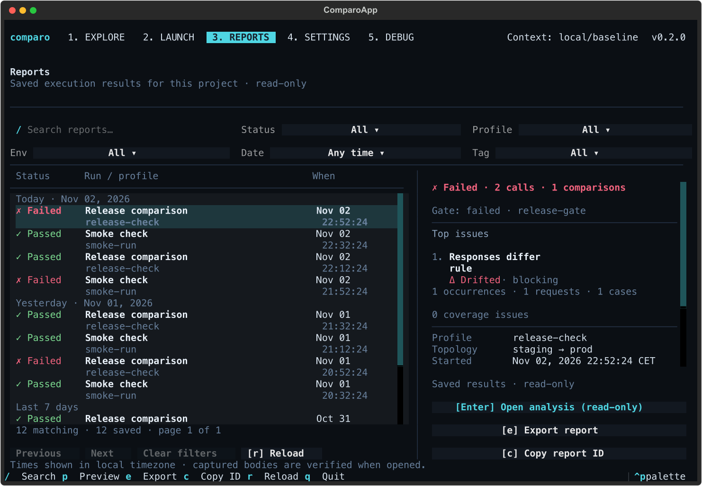

# comparo

> Validate HTTP behavior and selected semantic differences across environments.

Comparo executes the same logical HTTP input against environments such as development, staging,
and production. It evaluates per-environment assertions, compares selected environment pairs under
explicit diff profiles, and can reduce those facts into a CI gate verdict.

## Install

Requires **Python 3.13 or newer**. Install the published command with pipx:

```console
pipx install comparo
comparo --help
```

Alternatively, install into a Python virtual environment:

```console
python3 -m venv .venv
source .venv/bin/activate
python -m pip install comparo
comparo --help
```

To update an existing pipx installation, run `pipx upgrade comparo`.
The published version is currently **0.2.0**; this branch documents the proposed **0.3.0** release.
Its rebuilt commands and configuration become available through that release. To try this branch
before publication, use the [development setup](CONTRIBUTING.md#development-setup).

## Terminal preview



The upcoming 0.3.0 interface, captured from the running app with example report data.

## Status

Comparo is alpha software. The production core, local CLI, and terminal UI have been rebuilt
around the `comparo/v1alpha1` configuration lineage; the former prototype is quarantined and is
not a compatibility target. The canonical TUI is `comparo.tui`, with Explore, Launch, Reports,
Settings, and a component Debug gallery. Dedicated CI integration has not yet been migrated.

The [current implementation status](docs/status.md) records supported surfaces, remaining gaps,
and the distinction between this unreleased working tree and the older v0.2.0 release history.
The next version is prepared through a PR and [released by GitHub Actions](docs/releasing.md)
after CI and review; it has not been published yet.

The executable subset is deliberately fail-closed: configuration can describe more of the future
model than the first production runtime implements, and an execution command rejects unsupported
capabilities before resolving values, performing DNS, or opening a network connection. Review the
[current CLI limitations](https://github.com/wbenbihi/comparo/blob/main/docs/cli.md#current-executable-subset) before using Comparo for a real
service. This remains a pre-production release.

> [!WARNING]
> **AI Disclaimer**
>
> `comparo` was created as a personal initiative to learn and play with terminal user interface frameworks
> and coding agents for real-life use cases. This tool has been really handy for both my personal and corporate projects.
> Due to its **AI co-authoring**, and despite the fact I tried to require good development practices from an LLM agent,
> I cannot advise you to rely on this tool for production purposes in its current state. This warning will stay here until I have fully
> audited the code and can confidently release a prod-ready version.
>
> To be clear:
>
> **AI CODED THIS PROJECT BECAUSE I DIDN'T HAVE TIME TO SPEND ON IT. DO NOT BLINDLY TRUST THIS PROJECT, NOR ANY VIBE-CODED PROJECT YOU**
> **HAVE NOT FULLY UNDERSTOOD OR AUDITED.**


## CLI

The command graph includes offline schema, validation, planning, diagnostics, and sanitized render
journeys; shared production `run`, `diff`, and `exec` journeys; and authenticated artifact/report
readers. From a directory containing your `comparo.yaml` project:

```console
comparo --help
comparo validate --config comparo.yaml
comparo plan --config comparo.yaml --format json
comparo run --config comparo.yaml --env staging
comparo
comparo tui --config comparo.yaml
```

Local execution defaults to the explicitly permissive trusted-local authority. A project used in
CI or obtained from an untrusted source must be paired with an operator-owned policy outside that
project:

```console
comparo diff \
  --config comparo.yaml \
  --policy /operator/policies/comparo-ci.yaml \
  --baseline production \
  --candidate staging
```

See the [CLI reference](https://github.com/wbenbihi/comparo/blob/main/docs/cli.md) for headless commands, trust semantics, exit codes,
persistence, and runtime limits, and the [TUI guide](https://github.com/wbenbihi/comparo/blob/main/docs/tui.md) for the component-based terminal
journey.

## Terminal workflow

- Explore resources and send a selected Request or ExecutionProfile to Launch with `c`.
- Configure Target, prepare with Ctrl+R, review Plan, and execute with Ctrl+X.
- Follow live request status, timing and rule outcomes; explicitly open Analyze after completion.
- Reopen saved results in Reports using the same Analyze view. Press `i` to page captures,
  inspect JSON/SSE, or review a sanitized cURL command.
- Save a manual target as a new ExecutionProfile after reviewing its YAML.
- Use Settings for persistent appearance, mouse, startup-workspace and shortcut preferences.

These are default keys; Settings can remap the main workspace, Launch and Analyze commands.
See the [TUI guide](docs/tui.md) for controls and limits.

## Examples

The repository includes three runnable local projects backed by one deterministic loopback demo
service. They cover a passing quickstart, deliberate cross-Environment drift, Environment-local
values, execution profiles, and a larger two-Matrix TUI showcase. From a repository checkout,
start the demo in one terminal:

```console
python examples/support/demo_server.py
```

Then open the showcase in another terminal:

```console
comparo tui --config examples/tui-showcase/comparo.yaml
```

See the [example project guide](https://github.com/wbenbihi/comparo/blob/main/examples/README.md) for the expected outcomes and suggested
Explore, Launch, and Reports journeys.

## Architecture

The refactor is built from an immutable, framework-independent domain center. Configuration,
networking, persistence, CLI, and TUI concerns are adapters around that core.

- [Core/backend codebase golden reference](https://github.com/wbenbihi/comparo/blob/main/docs/codebase/README.md)
- [Core refactor roadmap](https://github.com/wbenbihi/comparo/blob/main/docs/core-refactor-roadmap.md)
- [Immutable core domain foundation](https://github.com/wbenbihi/comparo/blob/main/docs/core-domain-foundation.md)
- [Shared selector language](https://github.com/wbenbihi/comparo/blob/main/docs/selector-language.md)
- [Versioned configuration compiler](https://github.com/wbenbihi/comparo/blob/main/docs/configuration-compiler.md)
- [Deterministic run planner](https://github.com/wbenbihi/comparo/blob/main/docs/run-planner.md)
- [Run-scoped values and secrets](https://github.com/wbenbihi/comparo/blob/main/docs/run-scoped-values.md)
- [Production HTTP adapter](https://github.com/wbenbihi/comparo/blob/main/docs/production-http-adapter.md)
- [Sanitized artifacts, persistence, and reporters](https://github.com/wbenbihi/comparo/blob/main/docs/artifacts-and-reporters.md)
- [CLI reference](https://github.com/wbenbihi/comparo/blob/main/docs/cli.md)
- [Terminal UI](https://github.com/wbenbihi/comparo/blob/main/docs/tui.md)
- [Accepted architecture decisions](https://github.com/wbenbihi/comparo/blob/main/docs/decisions/README.md)

The canonical product promise, security boundary, configuration model, HTTP semantics, assertion
and diff pipelines, artifact rules, and compatibility policy are recorded in those documents.

## Development

Comparo requires Python 3.13 or newer and uses `uv` for reproducible environments:

```console
uv sync --frozen
uv run --frozen ruff check .
uv run --frozen ruff format --check .
uv run --frozen mypy
uv run --frozen lint-imports
uv run --frozen python -m pytest --cov --cov-report=term-missing
```

See [CONTRIBUTING.md](https://github.com/wbenbihi/comparo/blob/main/CONTRIBUTING.md) for repository conventions.

## License

[MIT](LICENSE) © Walid Benbihi
