# Architecture and boundaries

## Dependency direction

The core is organized around immutable data and narrow ports. Effects point inward; core packages
do not reach outward to discover an adapter.

```mermaid
flowchart LR
    YAML["YAML sources"] --> CA["configuration adapters"]
    POLICY["operator policy document"] --> PA["policy adapter"]
    CA --> CC["core configuration compiler"]
    PA --> PC["core policy compiler"]
    CC --> PLAN["core planner"]
    PC --> PLAN
    PLAN --> APP["application composition"]
    APP --> RES["run-scoped resolution"]
    RES --> RUN["bounded runtime"]
    RUN --> HTTP["HTTP adapter"]
    HTTP --> OBS["immutable observations"]
    OBS --> SEL["selection kernel"]
    SEL --> EVAL["assertion and diff kernels"]
    EVAL --> GATE["gate kernel"]
    GATE --> LIVE["live RunResult"]
    LIVE --> SAFE["sanitization and artifact compiler"]
    SAFE --> ART["RunArtifact + sanitized blobs"]
    ART --> STORE["artifact adapter"]
    ART --> REPORT["application projections/reporters"]
    REPORT --> UI["CLI / replacement TUI / CI"]
```

The important exception is `comparo.application`: it is a composition layer, not another pure
kernel. It imports the core contracts and concrete local adapters needed for the first production
vertical slice. Frontends depend on application DTOs and services.

## Package layers

| Layer | Package | Responsibility | May own effects? |
| --- | --- | --- | --- |
| Domain language | `comparo.core.domain` | Immutable identities, values, scopes, HTTP facts, selectors, rules, outcomes, budgets | No |
| Pure engines | `comparo.core.configuration`, `planning`, `selection`, `assertions`, `diffs`, `gates`, `policy` | Compile, bind, select, evaluate, and authorize typed inputs | No |
| Run services | `comparo.core.resolution`, `runtime`, `artifacts` | Coordinate injected providers, scheduling, live capture, and artifact compilation | Only through ports; resolution/runtime may coordinate async state |
| External adapters | `comparo.configuration`, `policy`, `adapters` | YAML/filesystem, ambient/env snapshots, HTTP, clocks, randomness, and persistence | Yes |
| Use cases | `comparo.application` | Assemble adapters and core services behind safe frontend contracts | Yes |
| Presentation adapters | `comparo.cli`, `comparo.reporters`, replacement TUI/CI | Parse commands and render safe application/artifact products | Only their own I/O |

`comparo.reporters` is deliberately pure even though it sits near frontends: reporters accept a
sanitized `RunArtifact` and produce bounded JSON, JUnit, SARIF, or Markdown bytes/text.

## State and lifetime owners

Most records are frozen `msgspec.Struct` values. Mutable state is concentrated in explicit
run- or service-owned objects.

| Owner | Lifetime | Mutable state |
| --- | --- | --- |
| `CompareService` | Interactive Compare workspace | Bounded map of one-shot admitted-plan handles |
| `ExecutionSession` | One interactive run | Task, cancellation signal, and latest coalesced progress snapshot |
| `RunContext` | One run | Provider caches, environment snapshots, cancellation, and sensitive-value registry |
| `TransientBodyStore` | One production run | Bounded memory/spooled response bodies |
| `ArtifactCapturingDriver` | One production run | Sanitized capture batches and coverage issues |
| `PosixSanitizedBlobSpool` | One artifact compilation | Content-addressed sanitized blobs before persistence |
| `LocalArtifactBundleSink` | One persist operation | Atomic filesystem transaction |

No project-global singleton owns resolved values, cookies, network clients, or secrets. Closing a
run releases caches, body storage, capture state, and sensitivity registry.

## Composition roots

### Project preparation

`prepare_project_plan` is the headless compile/policy/plan composition:

1. `compile_project_path` discovers and parses the project.
2. the selected operator policy is loaded and compiled;
3. `PlanningOptions` is translated to a typed `RunInvocation`;
4. `plan_run` produces a `PreparedRun` or value-free diagnostics;
5. `PreparedProjectPlan` retains the project root, external policy, and prepared plan.

Project configuration cannot supply its own ExecutionPolicy authority.

### Compare preparation and start

`CompareService.prepare` adds intent validation, runtime-capability admission, evaluation
capability admission, and a safe `PlanReviewInspection`. It retains the admitted plan behind a
bounded opaque handle. `start` consumes that handle only when the controls exactly match the
reviewed controls, then creates an `ExecutionSession`.

This prevents a UI from reviewing one set of mutation, artifact, or resource-limit settings and
executing another.

### Production execution

`execute_production` is the concrete run composition. It creates pinned project files,
Environment snapshots, a `RunContext`, evaluation preparation, transient body storage, the
`httpcore` transport, HTTP policy preparation, snapshot decoders, the capture decorator, the
runtime, artifact compiler, and optional local persistence. It returns exactly one sanitized
`RunArtifact` or a typed safe failure.

The initial composition contains hard-coded replaceable settings from
`production_execution_defaults_v1` or `persisted_production_execution_defaults_v1`. Domain types
may be broader than what this function currently binds from project configuration.

## The five representations of a project/run

“Raw” and “resolved” are insufficiently precise. A frontend must identify the representation it
is showing.

| Stage | Principal type | Contains | Secret-safe to render? | Retained by current application API? |
| --- | --- | --- | --- | --- |
| Authored source | `ParsedDocument` / source-located YAML nodes | Exact document structure and authored literals | No; may contain literal secrets | No, discarded after compilation |
| Compiled graph | `CompiledProject` | Linked resources and unresolved typed expressions | Not as a whole | Internally; Explorer receives a concealed outline only |
| Effective plan | `PreparedRun` / `RunPlan` | Selected resources, topology, matrices, counts, precedence, provenance, budgets | Safe only through inspection DTOs | Yes |
| Resolved wire intent | `FinalizedWireRequest` | Exact destination, headers, query, cookies, body | No; may contain live secrets | Only transiently; safe preview is sanitized |
| Observed/persisted result | `RunResult` then `RunArtifact` | Live outcomes, then sanitized manifest and blobs | `RunResult`: no; `RunArtifact`: yes | Artifact and projections are retained |

The current Explorer outline is compiled/effective **structure**, not raw YAML and not a resolved
wire request. The current render preview is resolved wire intent with mandatory sanitization, but
only for the executable body-free request subset.

## Security boundaries

### Live sensitivity

`SensitiveValue` is the in-process containment type. Value resolution seals secrets and all env
snapshot values, propagates taint through conversions/composition, and registers every wire value
with the same run-owned sanitizer snapshot. The type resists ordinary stringification, copying,
pickling, JSON/MessagePack encoding, and built-in conversion. It is accidental-leak protection,
not a sandbox against hostile Python running in the process.

### Authorization

The operator-owned ExecutionPolicy is loaded separately from project YAML. Planning authority,
HTTP route/method authority, filesystem roots, artifact roots, remote-schema authority, and secret
egress are explicit typed contracts. Destination authorization occurs after final resolution and
again across redirects; an admitted plan is not itself a network capability.

### Frontend boundary

Frontend-safe application DTOs contain coordinates, counts, fingerprints, sanitized artifact
values, or closed diagnostic codes. They do not contain adapter exception text or live values.
The following must not cross into presentation code:

- `SensitiveValue`, `RunContext`, or resolution registries;
- `FinalizedWireRequest` before sanitization;
- `EnvironmentExecutionObservation` or transient body handles;
- provider/transport exceptions;
- `CompiledProject` or authored YAML nodes as an informal inspection shortcut.

Raw-source support needs a deliberate separate service because a project may contain literal
secrets. It cannot safely be implemented by returning loader internals to the TUI.

### Persistence

Live results pass through `ArtifactCapturingDriver` and `compile_run_artifact`. Artifact DTOs are
independently serializable and cannot import live secret/run domains. Local bundles use private
directories, no-follow checks, content digests, bounded reads, and atomic writes. Archive listing
authenticates the marker, manifest, and results metadata; `verify_artifact` additionally reads and
authenticates every declared blob before full result/report projection.

The local persistence adapter is POSIX-specific. Windows persistence is not currently supported.

## Resource budgets

There is no immutable “maximum project size.” Limits are typed caller-owned settings and
operator-policy ceilings. Budgets exist at discovery/parsing, planning cardinality, resolution,
HTTP capture, transient storage, stream decoding, selection, evaluation/evidence, artifact
storage, report rendering, archive listing, and frontend projection windows.

The shipped defaults are operational choices, not schema invariants. A frontend should expose the
effective values and their provenance from `PlanInspection`; it should never silently increase a
limit after a plan has been reviewed.

## Enforced architecture rules

`pyproject.toml`, import-linter contracts, and AST architecture tests enforce, among other rules:

- core domain code cannot import CLI/TUI, HTTP clients, schema/YAML libraries, or adapter
  frameworks;
- configuration frontends cannot import canonical compiler stages;
- planning cannot use filesystem, network, ambient environment, clock, randomness, or schedulers;
- resolution and runtime use injected effects and cannot import production adapters;
- assertion, diff, and gate engines are independent;
- persistable artifact DTOs cannot import live run, planning, HTTP observation, or sensitivity
  domains;
- reporters cannot import adapters or live runtime domains;
- immutable carrier and secret-containment properties are tested structurally.

These rules explain why a missing application projection should be added at the application
boundary instead of solved by importing an internal model into a frontend.
