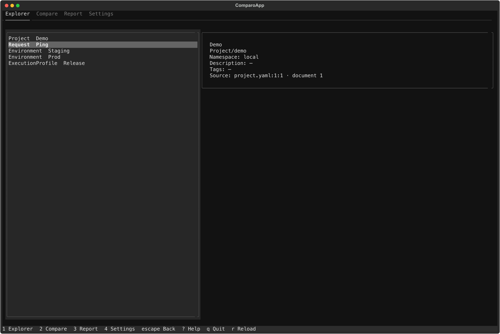
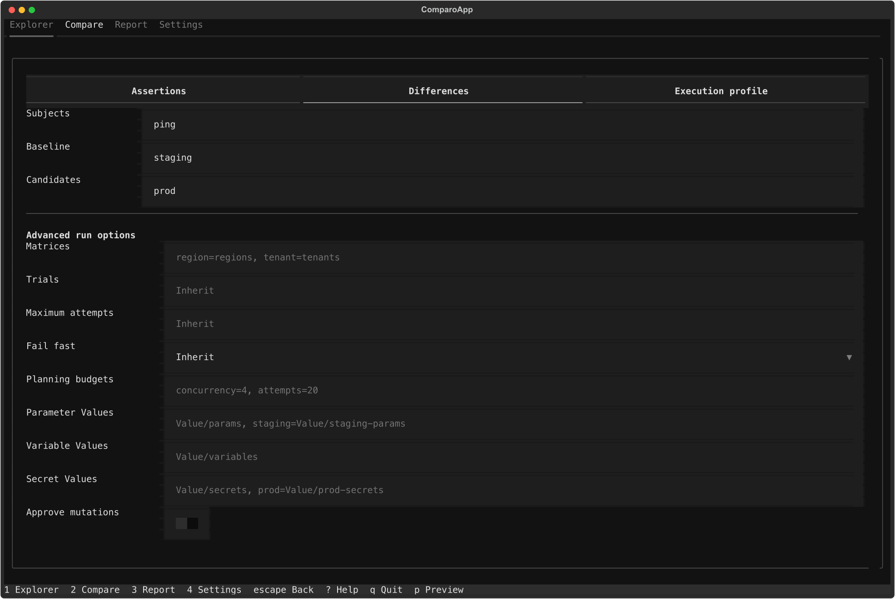
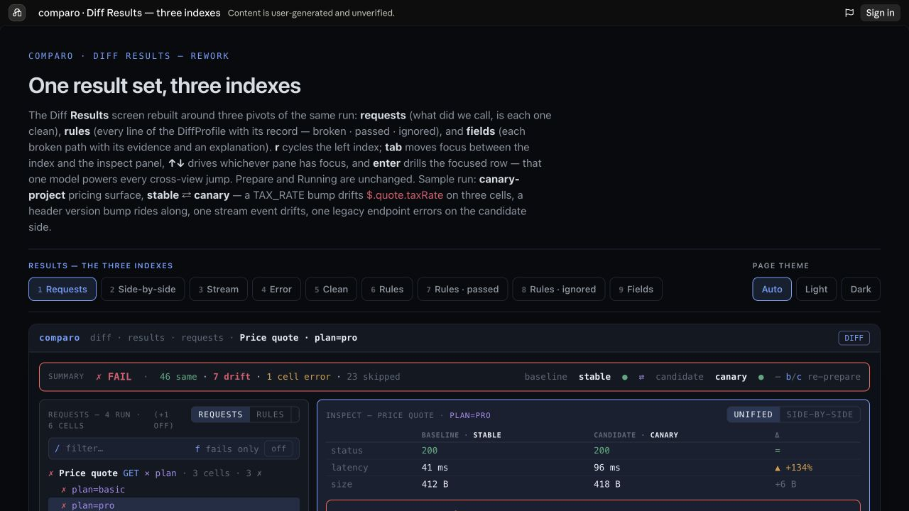
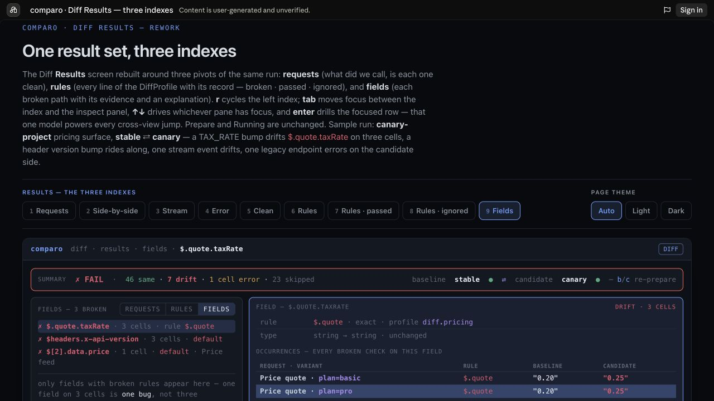
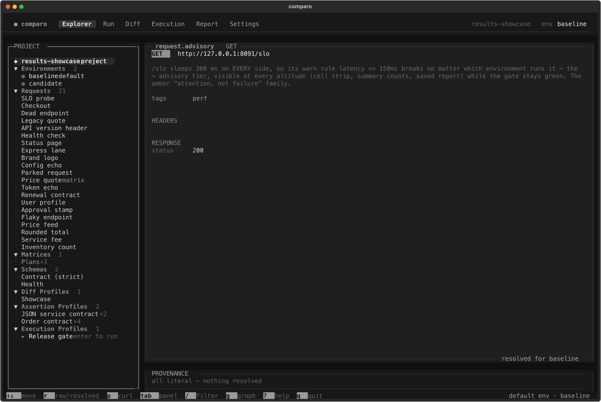
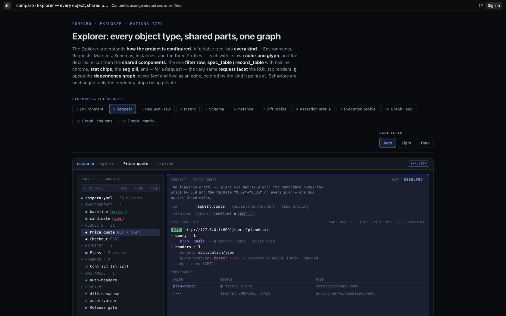
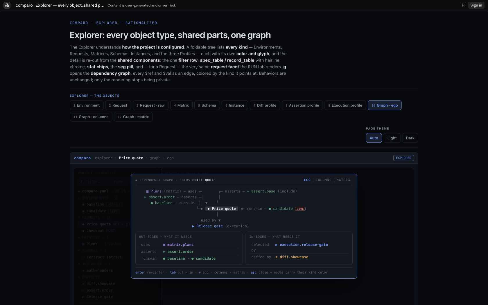
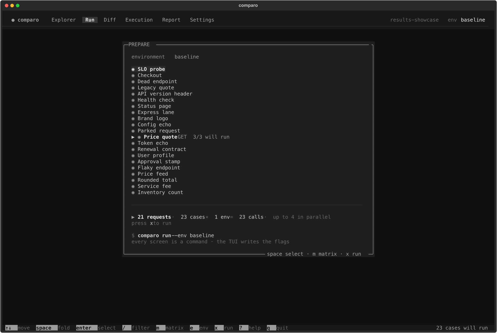
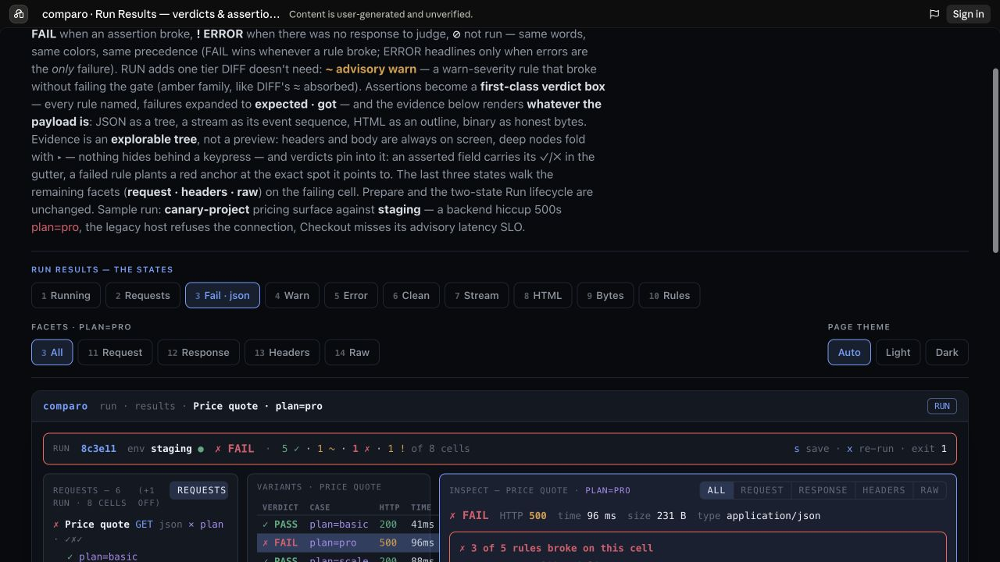
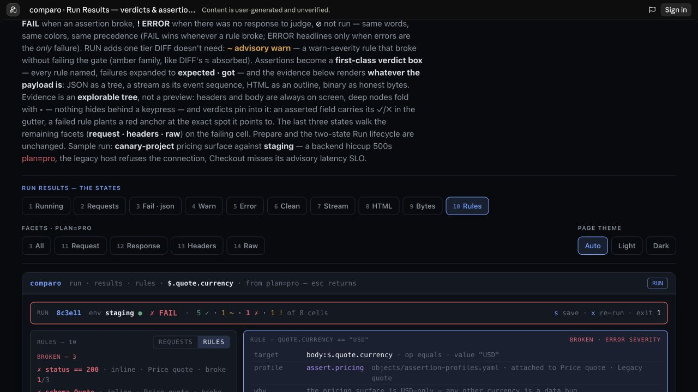

# Comparo TUI rework audit and implementation contract

Date: 2026-07-26
Target viewport: 160 columns × 52 rows
Status: approved; implementation in progress

The authoritative visual and interaction specification is the
[TUI v2 design contract](design/tui-v2/README.md). The generated screenshots in that contract are
the primary visual and information-design source. The clickable mockup is incomplete and may be
used only as a limited interaction reference. The rejected current TUI is never a source of truth.

## Outcome

The refactor preserved useful application boundaries and safety controls, but the
presentation layer regressed because it rebuilt interaction mechanics that Textual
already provides. This is not a CSS-only correction. The TUI presentation layer
should be rebuilt around native Textual widgets, bindings, focus behavior, mouse
events, reactive state, workers, and screen primitives while preserving the new
backend/application boundaries.

The previous mockups and `main` implementation are evidence and a quality bar, not
an implementation to copy. The target keeps the approved four-workspace information
architecture—Explorer, Compare, Report, Settings—and creates a new interaction
system appropriate for the refactored product.

## Evidence inspected

- Interactively explored all three supplied prototypes at a 1680-pixel-wide viewport,
  including Explorer raw/resolved and graph states, Run request/rule details, and Diff
  request/rule/field pivots.
- Launched the `main` branch TUI headlessly at 160 × 52 and exercised Explorer, Run
  preparation, and Diff preparation.
- Launched the current `refactor` TUI at 160 × 52 and captured Explorer highlight,
  Explorer activation, and Compare preparation states.
- Inspected the relevant event handlers, component composition, footer behavior,
  application projections, tests, and the installed Textual 8.2.8 implementation.

## 1. Current Explorer selection — critical

Moving the cursor changes the highlighted row but not the detail. The current list
posts a Comparo message only from `ListView.Selected`, so Enter or a selection click
is required. The workspace listens only for that custom message. This is the exact
cause of the stale detail shown below.



After Enter, the detail changes, but it is still a flat six-line summary without
resource-specific hierarchy, raw/resolved inspection, or dependencies.


Relevant implementation:

- [`ProjectResourceList`](../src/comparo/tui/components/project.py) handles
  `ListView.Selected` only.
- [`ExplorerWorkspace`](../src/comparo/tui/workspaces/explorer.py) updates the
  detail only after the custom `ResourceSelected` message.
- [`ProjectResourceDetail`](../src/comparo/tui/components/project.py) can only
  render resource identity, metadata, and source position.

## 2. Current Compare preparation — critical

The current screen expresses a structured domain selection as a long stack of text
inputs, including comma-separated resource identifiers. It creates excessive focus
stops, weak discoverability, manual parsing, no direct overview of selected objects,
and no visually dominant primary action.



This is not a typography problem. `CompareModeSelector` manually recreates tab state
with three buttons, while `CompareDraftForm` uses plain `Input` controls for typed
resources that should be selected from known project objects.

## 3. Interaction and footer — critical

The custom footer is rebuilt when the command ID signature changes, but its model is
workspace/surface state rather than the actually focused widget. It therefore cannot
reliably describe the actions available in the active pane. Re-mounting the footer is
also unnecessary.

Textual's native `Footer` already reads `screen.active_bindings`, responds to binding
updates, merges app/screen/focused-widget bindings, evaluates whether actions are
enabled, and makes each displayed key clickable by simulating that key. Comparo should
use that behavior directly.

## 4. Results and inspection depth — critical

The current live/stored result projection is intentionally manifest-only. That is a
safe base, but it cannot power the intended request/rule/field investigation journeys.
The missing depth must be implemented as safe application projections and lazy
artifact access—not reconstructed from raw bundles inside TUI widgets.

The reference interaction succeeds because one selected entity consistently drives
one inspector, while request, rule, and field pivots offer alternate ways into the
same evidence.





## 5. Refactor architecture and safety — healthy foundation, insufficient UI contract

The refactor correctly prevents TUI code from owning configuration compilation,
transport, secret resolution, artifact authentication, or result evaluation. Those
boundaries must remain. The correction is to add richer safe inspection use cases and
compose their outputs with Textual, not to move domain behavior back into the UI.

The old `main` TUI proves the value of native highlight and scrolling semantics, but
its very large `app.py`/`render.py`, direct domain access, and separate Run/Diff/
Execution tabs must not return.



## Native-Textual-first rule

Before adding a custom TUI primitive, the implementation must establish that a native
Textual primitive cannot satisfy the interaction. Custom Comparo components may
compose native widgets and add domain meaning; they must not recreate cursor state,
selection state, scrolling, focus traversal, footer dispatch, tabs, input validation,
or worker lifecycles.

| Product need | Textual mechanism to use |
|---|---|
| Logical project hierarchy | `Tree`; `NodeHighlighted` previews, `NodeSelected` activates |
| Result indexes and cell/rule/field pivots | `DataTable` with row cursor/highlight events |
| Multi-select requests, scenarios, candidates | `SelectionList` |
| Single environment/profile selection | `Select` |
| Compare mode and detail facets | `Tabs` / `TabbedContent` |
| Advanced execution options | `Collapsible` |
| Primary and secondary actions | `Button` with semantic variants |
| Long details and independent panels | `VerticalScroll` / `HorizontalScroll` |
| Contextual, clickable shortcuts | `Binding` + native `Footer` + active bindings |
| Local interactive state | Textual `reactive` values and `watch_*` methods |
| Async prepare/run/archive work | Textual workers with explicit groups/exclusivity |
| Modals such as help, selectors, curl | `ModalScreen`; normal deep views use screens/widgets |
| Rich hierarchy and semantic text | Rich renderables inside `Static`, table cells, and tree labels |

## Target product design

### Global shell

- Four workspaces only: Explorer, Compare, Report, Settings.
- Native tabs remain mouse-clickable and keyboard-addressable.
- Native `Footer` displays the active bindings for the focused widget and state.
- The command palette remains available for discoverability.
- Focus, hover, selection, and activation are distinct visual states.
- Wide layout is the primary design. Compact/narrow modes are fallbacks, not the
  acceptance target.

### Explorer

Wide layout: approximately 30% project tree and 70% inspector.

- A filterable `Tree` groups resources by kind and shows counts and concise semantic
  labels.
- Cursor movement or mouse click immediately updates the inspector through
  `NodeHighlighted`; Enter performs the resource's primary action only.
- The inspector has resource-specific Overview, Resolved, Raw, and Dependencies
  facets. Facets unavailable for a kind are hidden or disabled, not empty.
- Resolved request inspection includes the chosen environment and matrix case, method,
  URL, query, headers, body summary, provenance, and diagnostics.
- Dependencies exposes inbound/outbound references and allows navigation to linked
  resources. A visual graph can be a secondary view after the dependable tree/table
  representation exists.
- Raw and resolved views are always application-projected and redacted before reaching
  the TUI.





### Compare — prepare

State model: Draft → Planning → Ready → Running → Results.

- Native mode tabs select Assertions, Differences, or Execution Profile. Future
  Scenarios join the same mode surface rather than creating another workspace.
- The left pane contains type-aware selectors: request/scenario selection, environments,
  assertion/diff profile, and execution profile as appropriate to the active mode.
- Baseline is a `Select`; candidates use a `SelectionList` so multi-environment
  comparison remains possible without parsing free-form text.
- Defaults from project configuration and execution profiles are preselected; TUI
  overrides are visibly identified as session overrides.
- The right pane is a live plan/readiness summary: selected subjects, expanded matrix
  cells, calls per environment, policy/budget notices, writes, and diagnostics.
- Advanced execution controls live in a collapsed `Collapsible` section.
- A persistent action row provides an obvious mouse-clickable primary action and its
  binding: `Preview plan`, then `Run N cells` once admitted. Cancel replaces it while
  running.
- Tab moves between major zones, not every logical item. Arrow keys operate inside the
  native list/select widget.

The old main preparation screen demonstrates density and a clear run summary, but the
new screen will use the approved single Compare workspace and native selectors.



### Compare — running

- One summary strip shows progress, calls, cells, assertions/diffs, elapsed time, and
  current gate state.
- A `DataTable` streams cell updates without stealing focus.
- The selected cell's detail updates on row highlight.
- Cancellation is visible, bound, clickable, and reports cancellation progress.
- High-frequency progress is coalesced as it is today; the UI does not render every
  low-level event.

### Compare — results

- Assertions and diffs share one results frame rather than separate implementations.
- Wide layout uses a two- or three-pane composition: pivot index, optional cell/variant
  list, and inspector.
- Diff supports Requests, Rules, and Fields pivots; assertions support Requests and
  Rules. All pivots resolve to the same stable result references.
- Highlight updates detail; Enter drills into the selected evidence or cross-links to
  another pivot. Escape returns one level through native screen/local navigation.
- Inspector facets include Summary, Request, Response, Headers, Body/Events, Rules,
  and Evidence where applicable.
- Unified/side-by-side is a native facet or binding-backed state, not a parallel screen.
- Large bodies are fetched lazily through storage handles and rendered with bounded
  windows; secrets are redacted before presentation.





### Report

- The archive list uses `DataTable` with status, mode, environments, time, duration,
  and counts.
- Opening a report mounts the exact shared results frame used by live Compare in a
  read-only context.
- No second report renderer or second navigation grammar is permitted.

### Settings

- Settings remains limited to TUI preferences: theme, density, default workspace,
  mouse behavior, and related local presentation choices.
- Project configuration remains inspectable in Explorer and editable outside this TUI.

## Required application projections

These are application capabilities, not TUI domain shortcuts:

1. `ResourceInspection`: kind-aware, redacted overview data.
2. `ResourceSourceView`: sanitized authored/normalized representation with source
   provenance; no arbitrary file reads by the TUI.
3. `ResolvedResourceInspection`: selected environment/matrix case, resolved values,
   diagnostics, and provenance.
4. `ResourceDependencyGraph`: stable inbound/outbound resource references.
5. `ResultSummaryProjection`: mode, gate, counts, timings, environments, and run state.
6. `ResultIndexProjection`: request/rule/field/cell rows with stable typed references.
7. `ResultDetailProjection`: redacted metadata and bounded inline evidence.
8. `ArtifactContentLease`: authenticated, bounded, lazy body/event retrieval through
   the existing storage abstraction.

## Component boundaries

```text
core/domain
    ↓
application use cases and safe projections
    ↓
TUI presenters (safe projection → Rich renderable / table rows)
    ↓
semantic Comparo widgets (compose native Textual widgets; define bindings/messages)
    ↓
workspace layouts (composition only)
    ↓
Comparo app shell
```

- Application code owns resolution, evaluation, planning, storage access, redaction,
  and policy enforcement.
- Presenters are pure and convert already-safe values into Rich renderables.
- Semantic widgets own local view state and Comparo-specific messages, while native
  Textual widgets own mechanics.
- Workspaces only compose reusable components and wire semantic messages.
- The shell owns global workspaces, services, and global bindings—not per-widget input
  routing.

## Implementation order and incremental commits

1. **Acceptance contract and fixtures** — preserve these wide screenshots; add Pilot
   tests for highlight, mouse, focus zones, footer context, and primary actions.
2. **Native shell** — replace the custom footer/dispatcher integration with Textual
   bindings and `Footer`; establish focus, theme, hover, panel, and wide-layout rules.
3. **Explorer projections** — implement safe resource detail, raw/resolved, and
   dependency application use cases.
4. **Explorer UI** — replace the flat list/detail with native `Tree`, facets, scrollable
   semantic detail, filtering, and linked dependency navigation.
5. **Compare prepare** — replace free-form resource inputs and custom mode buttons with
   `Tabs`, `Select`, `SelectionList`, `Collapsible`, readiness, and a clear action row.
6. **Running and result projections** — add stable request/rule/field/cell indexes and
   lazy bounded evidence while retaining the storage/security boundary.
7. **Shared running/results UI** — build the reusable `DataTable`-driven frame and use
   it for assertions, diffs, execution profiles, and future scenarios.
8. **Report reuse** — mount the shared results frame for archived bundles.
9. **Polish and independent acceptance** — keyboard-only, mouse-only, multiple terminal
   sizes/themes, large projects, slow progress, errors, cancellation, accessibility,
   security, and visual review.

Each numbered item is split into small conventional commits. The implementation does
not proceed to the next workspace until the current one meets its interaction and
visual acceptance checks.

## Definition of done

- The primary acceptance viewport is 160 × 52; wide panels do not collapse into the
  mobile/vertical presentation there.
- Highlighting any Explorer or result row updates the dependent detail immediately.
- Mouse users can click tabs, rows, facets, selectors, actions, and footer keys; the
  wheel scrolls the hovered scrollable pane.
- Keyboard users move within a pane using the native widget's navigation and need no
  more than two Tab presses to reach another major zone.
- Every state has one obvious primary action that is both clickable and bound.
- The footer changes with the active workspace, state, focused widget, and available
  action; unavailable actions are absent or disabled.
- Explorer exposes meaningful resource-specific detail plus Raw, Resolved, and
  Dependencies where valid.
- Compare exposes Draft, Planning, Ready, Running, and Results states without separate
  Run/Diff/Execution workspaces.
- Live Compare and archived Report use the same results components and presenters.
- Requests, rules, fields, matrix cells, stream events, and evidence are navigable from
  stable typed references.
- No TUI module resolves secrets, interprets configuration, evaluates rules, performs
  HTTP, or reads arbitrary artifact/source paths.
- Pilot tests cover highlight, click, wheel, focus, bindings, state transitions, and
  back navigation; visual snapshots cover every major wide-screen state.
- Acceptance is repeated in at least two real terminal environments in addition to the
  Textual test harness.

## Accessibility risks and checks

- Status and selection cannot rely on color alone; glyphs and text labels remain.
- Focus, hover, cursor, selected, disabled, warning, and error states need distinct
  styles in both light and dark themes.
- Dense tables require stable headings and plain-language detail summaries.
- Shortcut labels must match the active control and stay operable by mouse.
- Reduced-color terminals and terminals without mouse support remain fully operable by
  keyboard.
- Terminal screen-reader behavior varies and cannot be inferred from screenshots; it
  needs targeted manual validation and documented limitations.

## Evidence limits

- The supplied references are browser-rendered prototypes, so they demonstrate product
  hierarchy and interaction but not Textual performance or terminal compatibility.
- Headless Pilot captures validate rendering and key-driven state; they do not prove
  behavior across terminal emulators, SSH/tmux, or assistive technology.
- The audit did not execute real HTTP comparisons because the current usability defects
  are reproducible before execution. Running/result acceptance will use deterministic
  local fixtures during implementation.
